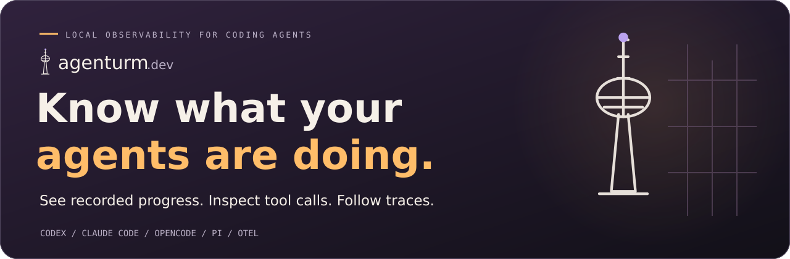
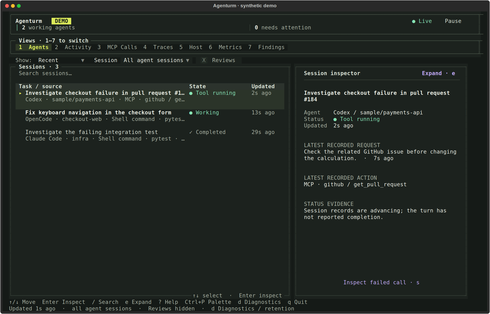

<p align="center">
  <a href="https://www.agenturm.dev/">
    
  </a>
</p>

<p align="center">
  <strong>Follow Codex, Claude Code, OpenCode, and Pi from one terminal.</strong><br>
  See recorded progress, inspect tool calls, and find what needs your attention.
</p>

<p align="center">
  <a href="https://www.agenturm.dev/#demo"><strong>Try the interactive demo →</strong></a> &nbsp;·&nbsp;
  <a href="docs/usage.md">Documentation</a> &nbsp;·&nbsp;
  <a href="docs/privacy.md">Privacy boundaries</a>
</p>

<p align="center">
  <a href="https://github.com/abhishekash/agenturm/actions/workflows/ci.yml"></a>
  <a href="https://www.agenturm.dev/"></a>
  <a href="docs/privacy.md"></a>
  <a href="LICENSE"></a>
</p>

## The view from your terminal

<p align="center">
  <a href="https://www.agenturm.dev/#terminal">
    
  </a>
</p>

<p align="center"><sub>Actual terminal UI · synthetic example records · <a href="docs/investigation-video.md">Watch the walkthrough</a></sub></p>

## Start here. Stay in your terminal.

Requires **Python 3.11+**, Git, and [uv](https://docs.astral.sh/uv/getting-started/installation/).

On macOS or Linux, install and launch:

```bash
curl -fsSL https://www.agenturm.dev/install.sh | bash
agenturm
```

[Review the installer](https://www.agenturm.dev/install.sh) before running it. On Windows—or if you prefer to install with uv directly:

```bash
uv tool install --force git+https://github.com/abhishekash/agenturm
agenturm
```

Or try it once without installing the command:

```bash
uvx --from git+https://github.com/abhishekash/agenturm agenturm
```

## Find what needs your attention

Start with your recent supported agent sessions. Select a record, inspect the evidence, and follow its trace—all in a keyboard-first terminal interface.

| Start with… | Then inspect… |
| --- | --- |
| **Agents** — sessions, projects, status, and last update | A session's task, recorded progress, current work, and reported waits |
| **Activity** — what happened in a session | Recorded prompts, messages, shell commands, file changes, and errors |
| **MCP calls** — tools and servers | Arguments, responses, failures, duration, and linked execution |
| **Traces** — how a run fits together | Parent and child operations, model usage, and errors |
| **Host and metrics** — runtime and reported usage | Known local processes, host details, and recorded OTLP metrics |

Recent supported Codex, Claude Code, OpenCode, and Pi records are discovered locally—without restarting your agents. Other supported tools can send telemetry through OpenTelemetry to the local receiver.

Agenturm is a monitor, not a controller. Reply to agents and approve requests in their own terminals.

### Keyboard first

| Key | Action |
| --- | --- |
| `1`–`7` | Switch views |
| `↑` / `↓`, `Enter` | Select and inspect a record |
| `/` | Search the current view |
| `e` | Expand details |
| `t` | Follow the linked trace |
| `Esc` / `Alt+←` | Return or navigate back |
| `c` | Copy details |
| `d` | Open collection diagnostics |
| `x` | Preview and export selected evidence |
| `q` | Quit |

### Four terminal themes

Press **Ctrl+P → Theme** to choose **Current** (Alpine Ember), **Bright**, **Dark**, or **Solarized**. The selected palette carries through panels, tables, controls, and evidence inspectors.

## Local by default

Supported records and telemetry are stored in local SQLite. The built-in receiver listens on `127.0.0.1:14318`. **Local monitoring and recorded-progress summaries need no account or API key.**

Captured messages, commands, and tool results can contain sensitive project information. Recognizable credentials are redacted on a best-effort basis. Use `--metadata-only` to omit native session text, commands, and outputs from future ingestion. [Read what is collected and where it goes](docs/privacy.md).

Recorded-progress summaries work locally. Optional AI summaries call your configured provider only when explicitly requested. The documented session evidence can include task and action text; review [AI summary setup and data](docs/usage.md#optional-ai-summaries) before enabling one.

## Integrations and documentation

- [Complete usage guide](docs/usage.md) — installation, local discovery, keyboard shortcuts, and troubleshooting.
- [Integrations guide](docs/frameworks.md) — Pydantic AI, Google ADK, Gemini CLI, and other OTLP agents.
- [Python integrations and automatic SDK capture](docs/python.md)
- [JavaScript client](docs/javascript.md)
- [Receiver and OTLP configuration](docs/receiver.md)
- [Resource budgets and benchmarking](docs/performance.md)
- [Capture and privacy boundaries](docs/privacy.md)
- [Brand and terminal themes](docs/branding.md)

For conversational queries over recorded MCP executions, see [SpanHound](https://github.com/abhishekash/spanhound), the companion MCP tool.

## Develop

```bash
git clone https://github.com/abhishekash/agenturm.git
cd agenturm
uv sync
uv run agenturm
uv run python -m unittest discover -s tests -v
```

See [CONTRIBUTING.md](CONTRIBUTING.md) for development and demo production. [Issues](https://github.com/abhishekash/agenturm/issues) and focused pull requests with clear reproductions are welcome.

<details>
<summary>Upgrading from Agent Observatory</summary>

Agenturm is the new name. Install from this repository to get the `agenturm` command. Existing Python imports (`observatory`), `OBSERVATORY_*` settings, telemetry keys, and `observatory.db` history continue to work. The previous command is retained as an alias. The source install above works independently of PyPI publication.

</details>

---

**Agenturm** is open source under the [MIT license](LICENSE). Read more at [agenturm.dev](https://www.agenturm.dev/).
