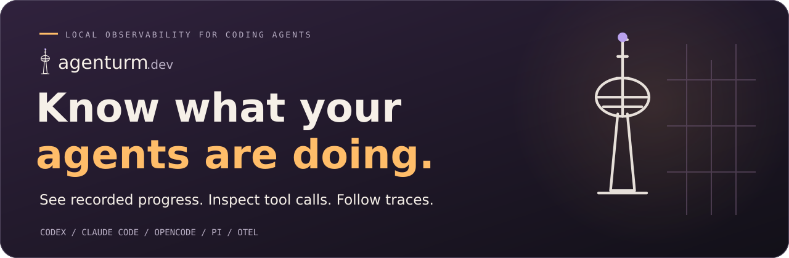
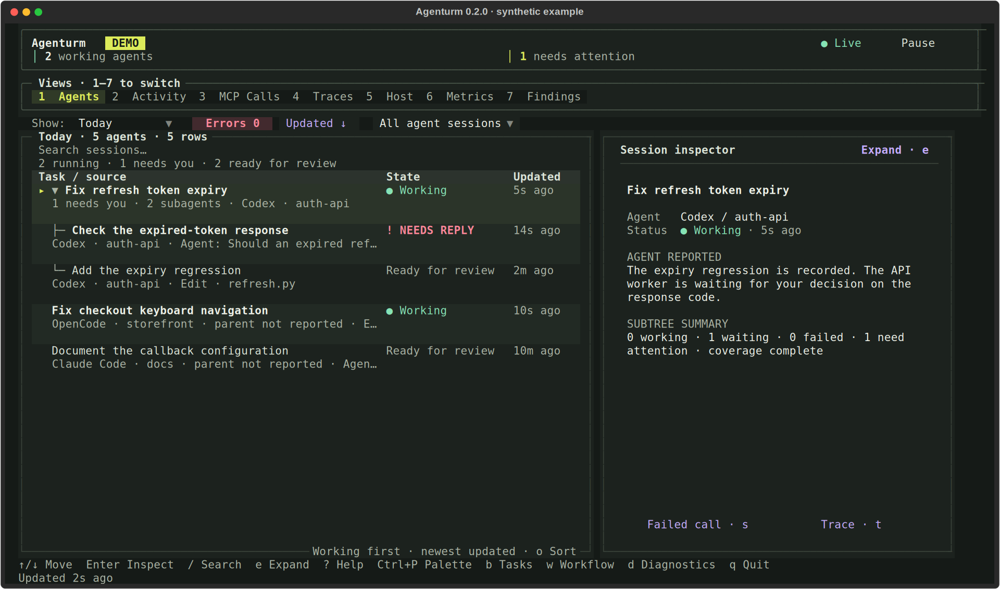

<p align="center">
  <a href="https://www.agenturm.dev/">
    
  </a>
</p>

<p align="center">
  <strong>One terminal to understand your agents’ work.</strong><br>
  See who needs you, read what happened, and keep the context for the next session.
</p>

<p align="center">
  <a href="https://www.agenturm.dev/#demo"><strong>Explore the workflow →</strong></a> &nbsp;·&nbsp;
  <a href="docs/usage.md">Documentation</a> &nbsp;·&nbsp;
  <a href="https://github.com/abhishekash/agenturm/releases/tag/v0.2.3">What’s new in 0.2.3</a>
</p>

<p align="center">
  <a href="https://github.com/abhishekash/agenturm/actions/workflows/ci.yml"></a>
  <a href="https://pypi.org/project/agenturm/"></a>
  <a href="docs/privacy.md"></a>
  <a href="LICENSE"></a>
</p>

## Keep a clear view as the work spreads out

You have Codex implementing a change, Claude Code reviewing another project, and a worker checking tests. A session asks a question. Another reports “done.” Tomorrow, you need to remember why you chose an approach.

**Agenturm brings those threads into one local, keyboard-driven workspace.** It reads supported local agent records and configured OpenTelemetry signals, stores them in SQLite, and connects the current session to its recorded work.

| When you need to… | Agenturm gives you… |
| --- | --- |
| Decide which terminal to return to | Working sessions, explicit waits, an attention inbox, and reported completions awaiting review |
| Understand a team of agents | Expandable parent/worker trees when the runtime records exact delegation; each worker has its own inspector |
| Catch up without rereading a transcript | A human-readable task, recorded progress, and **Overview / Prompts / Details** |
| Assess an agent’s “done” | Recorded checks, errors, later edits, and coverage limits in **Review** |
| Investigate a broken tool call | Captured MCP arguments, responses, duration, and a linked trace when available |
| Continue the task in another session | A saved brief, versioned decisions, linked runs, workspace capture, and a handoff you review before sharing |

Reply to agents and approve their requests in their own terminals. Agenturm monitors their work; it does not launch or control them.

## See it in action

<p align="center">
  <a href="https://www.agenturm.dev/#demo">
    
  </a>
</p>

**[Try the interactive walkthrough on agenturm.dev →](https://www.agenturm.dev/#demo)**

[Watch the 37-second terminal walkthrough](media/product/walkthrough.mp4) · [Animated preview](media/product/walkthrough.gif) · [Written transcript](media/product/walkthrough.txt)

Follow a refresh-token fix: find a worker that needs input, read the requests, inspect a reported test result alongside a later edit, investigate a failed MCP call, and preview a handoff. The browser walkthrough is a simplified, interactive explanation. Screenshots are captured from the actual v0.2.0 terminal. All demo records are synthetic.

## Get your first useful view

Requires **Python 3.11+** and [uv](https://docs.astral.sh/uv/getting-started/installation/).

Keep your coding agents open. In another terminal, run:

```sh
uvx agenturm
```

Agenturm starts or attaches to its local receiver. Recent supported **Codex, Claude Code, OpenCode, and Pi** records are discovered locally; those agents do not need a restart. No Agenturm account, subscription, or provider API key is needed for local monitoring.

1. In **Agents**, select a session with `↑` / `↓`. Expand a recorded delegation with `→`.
2. Press `Enter` to inspect. Use **Overview** to catch up, **Prompts** to read requests, and **Details** for source and usage information.
3. Open **Review** for the selected session’s captured checks and edits. Press `w` for the attention inbox or `b` to save the task for later.

An empty screen means no supported recent records have been discovered yet. Run a supported agent and open collection diagnostics with `d`. Agenturm does not seed your workspace with example sessions. See [discovery, custom paths, and troubleshooting](docs/usage.md#local-agent-discovery).

For a persistent command:

```sh
uv tool install agenturm
agenturm
```

To upgrade, run `uv tool upgrade agenturm`, then restart Agenturm and any separately running receiver. [Other installation methods](docs/usage.md#install-and-launch-the-terminal-cockpit).

## From activity to understanding

### See the agent and its workers

**Today** puts active work and work needing review within reach; **History** keeps earlier sessions available. Search by task or project. Switch between the tree and flat list with `f`.

The roster uses **In progress**, **Needs attention**, and **Ready for review**, with precise status evidence in the inspector. Spaced task blocks and deeper tree guides keep workers readable.

Task labels stay anchored to the **first substantive recorded request**. Model changes, acknowledgements, and later steering stay in Prompts without renaming the task. The source line stays short; recent activity and status evidence live in the inspector. [Task identity and capture limits](docs/session-task-labels.md).

A parent and its workers retain independent states. A completed parent can still have a working child; the branch summary makes that visible. Missing parent evidence stays explicit. Relationships use exact runtime identifiers, rather than guesses from similar tasks or nested spans. [Hierarchy support and limits](docs/agent-hierarchy.md).

### Read the request with its context

**Overview** collects the latest agent-reported update, recorded work, results, and delegated children. **Prompts** gives each request a readable place of its own, separates captured runtime scaffolding, and keeps the original text available. **Details** holds IDs, provenance, and reported usage.

In Prompts, `↑` / `↓` chooses a request; `Enter` / `→` moves into the reader and `←` returns to the request list. `[` / `]` changes requests from the reader; `z` shows the original text. Reading positions survive section changes. [Complete keyboard guide](docs/keyboard-navigation.md).

### Review the evidence behind “done”

**Ready for review** means an agent reported completion. Open **Review** to inspect the captured checks, failures, edits, and coverage for that session. A passing command followed by a later edit is different from a check on the current files. Loaded evidence can be partial; the interface says so.

Marking a run reviewed records your acknowledgement. Agenturm does not execute a fresh test suite or certify the change. MCP and trace inspectors let you go deeper when the producer recorded the corresponding arguments, results, and execution links.

### Keep the task across sessions

Press `b` to save a task. Write the intent, acceptance criteria, constraints, open questions, and next action. Record accepted or rejected approaches with their rationale. Link runs deliberately and capture workspace changes when you need a handoff.

**Handoff** previews the saved brief, decisions, linked evidence, and captured diff before you copy it or export Markdown + self-contained HTML. Paste it into the agent you choose. Saved tasks are local and remain editable while the receiver is offline.

The same workflow is available from the CLI:

```sh
# Creates a task and prints its ID. Use that ID in the commands below.
agenturm task create --title "Fix refresh token expiry" --workspace . \
  --notes "Keep the public API. Next: add an expiry regression." --snapshot

agenturm task brief TASK_ID --intent "Reject expired refresh tokens" \
  --next-action "Add the expiry regression, then rerun tests"
agenturm task decide TASK_ID --kind accepted --text "Keep the public API" \
  --rationale "Existing clients depend on it"
agenturm task handoff TASK_ID --output ./refresh-handoff.md
```

The export creates `.md` and `.html` files and refuses to overwrite existing destinations. Workspace capture reads Git changes; it does not run checks or attribute every edit to one agent. [Saved tasks, decisions, and handoffs](docs/saved-tasks.md).

## Connect the tools you already use

| Source | How it connects | What to expect |
| --- | --- | --- |
| Codex, Claude Code, OpenCode, Pi | Automatic discovery of supported local records | Recent sessions and recorded activity; available signals depend on runtime and record format |
| Pydantic AI, Google ADK, Gemini CLI, and other supported OTLP producers | Configure OpenTelemetry export to the local receiver | Emitted traces, logs, metrics, and correlation identifiers |
| Supported Python SDKs | Explicit automatic-capture launcher or documented integration | Captures supported SDK calls; existing processes may need a restart through the launcher |
| Your own Python or JavaScript agent | Instrument with the clients or OTLP | Only the evidence and identifiers your producer emits |

Exact delegation is supported for documented Codex, Claude Code, and OpenCode shapes. Automatic Pi subagent linking is not independently verified. A nested telemetry span alone is not treated as an agent. See the [integration guide](docs/frameworks.md), [Python capture](docs/python.md), [JavaScript client](docs/javascript.md), and [receiver configuration](docs/receiver.md).

## Local storage, explicit sharing

The built-in receiver defaults to **`127.0.0.1:14318`**. Local monitoring and recorded-progress summaries work without a cloud service. Saved tasks use a separate local database, so telemetry retention does not delete your brief or decisions.

Captured messages, commands, and tool results can contain project secrets. Credential redaction is best effort. `--metadata-only` omits native session content from future ingestion; it does not erase existing records. Saved workspace captures and handoffs need your own review before sharing. [Capture and privacy boundaries](docs/privacy.md).

Optional AI summaries send documented session evidence to your configured provider only when explicitly requested. [AI summary setup and data](docs/usage.md#optional-ai-summaries).

## The keys you’ll use every day

| Key | Action |
| --- | --- |
| `1`–`7` | Agents, Activity, MCP Calls, Traces, Host, Metrics, Findings |
| `↑` / `↓`, `Enter` | Select and inspect |
| `→` / `←`, `f` | Expand/collapse agents; switch tree/flat presentation |
| `/`, `o` | Search; choose sort order |
| `Ctrl+←` / `Ctrl+→`, `m` | Switch inspector sections |
| `Tab` / `Shift+Tab` | Move between controls |
| `w`, `b` | Attention inbox; saved tasks |
| `t`, `x`, `c` | Linked trace; evidence export; copy details |
| `Esc` / `Alt+←` | Return / navigate back |
| `F1`, `?`, `Ctrl+P` | Contextual help, help, command palette |
| `q` | Quit |

Choose **Current (Alpine Ember), Bright, Dark, or Solarized** through `Ctrl+P → Theme`. See the [daily workflow guide](docs/usage.md) for the full interface.

## Status and contributing

Agenturm is open source under the [MIT license](LICENSE). Version **0.2.3** includes the agent hierarchy, readable inspector, completion review, attention inbox, and saved-task continuity workflows. Signal coverage depends on the source. Long-session memory behavior remains under investigation; see the [validation report](docs/rigorous-validation.md) for measurements and limits.

```sh
git clone https://github.com/abhishekash/agenturm.git
cd agenturm
uv sync
uv run agenturm
uv run python -m unittest discover -s tests -v
```

[Contributing](CONTRIBUTING.md) · [Issues](https://github.com/abhishekash/agenturm/issues) · [Release notes](CHANGELOG.md) · [Resource budgets](docs/performance.md)

For conversational queries over recorded MCP executions, see [SpanHound](https://github.com/abhishekash/spanhound).

<details>
<summary>Upgrading from Agent Observatory</summary>

Agenturm is the new name. Existing Python imports (`observatory`), `OBSERVATORY_*` settings, telemetry keys, and `observatory.db` history remain supported. Use the `agenturm` executable.

</details>
