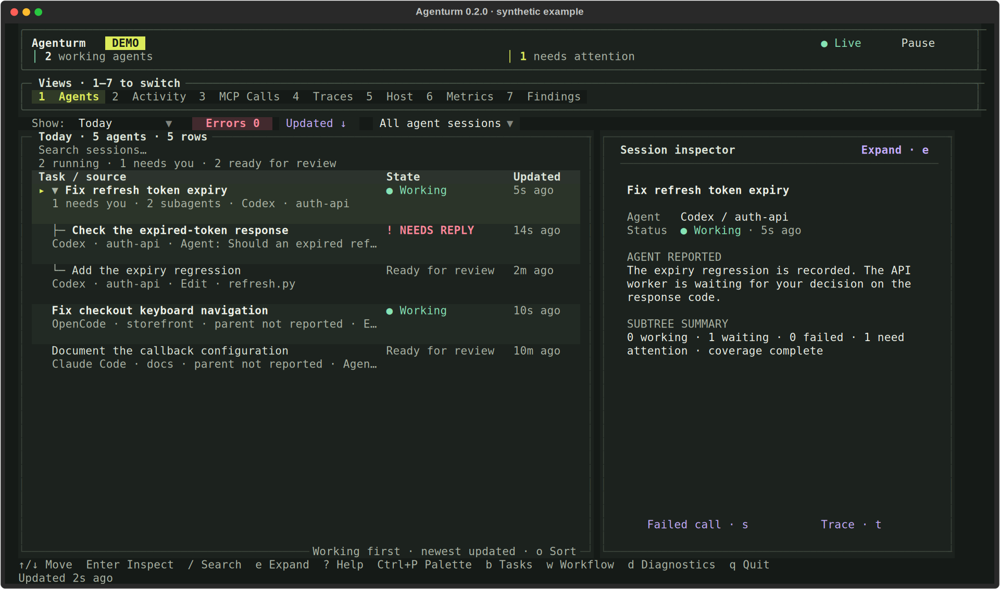
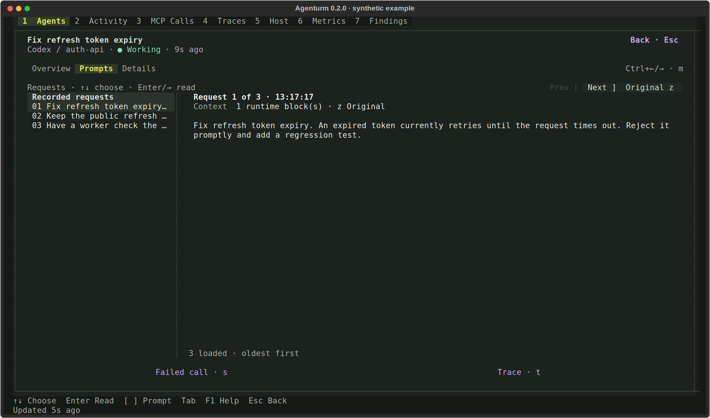
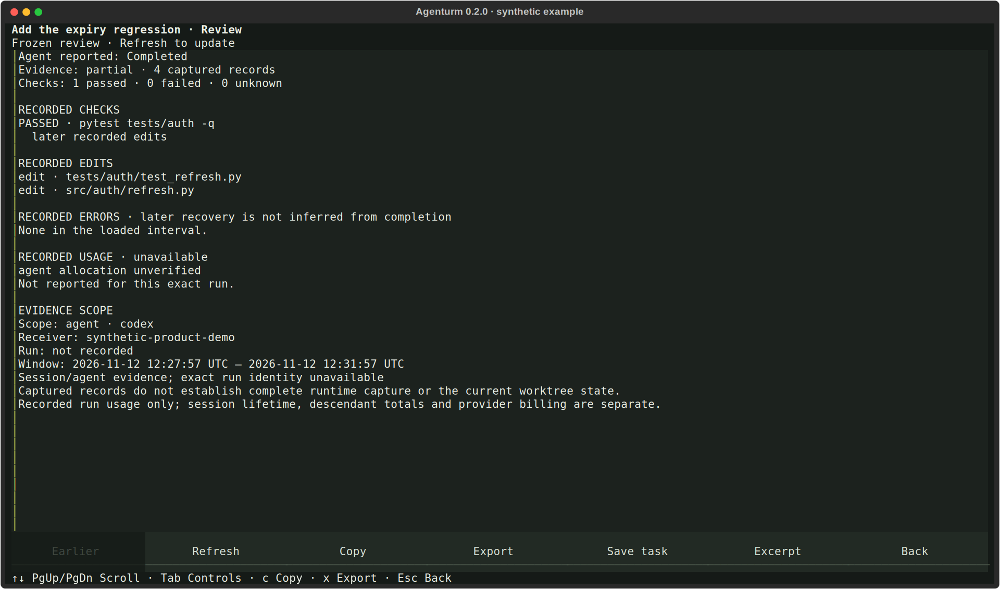
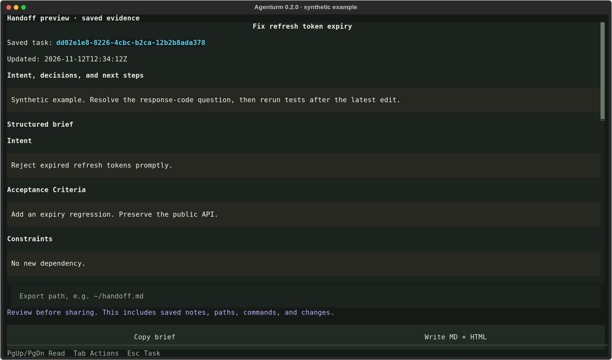

# Agenturm 0.2.0 product walkthrough

The README and agenturm.dev explain one developer workflow: find where you are needed, understand the recorded work, then continue with deliberate context.

## What the earlier presentation missed

The earlier README mixed a feature inventory, UI implementation detail, keyboard instructions, and installation before establishing a coherent daily workflow. The website’s demo concentrated on one MCP interruption. Neither gave the recent completion-review and task-continuity features enough room to explain their value. The website also still identified the product as 0.1.5.

The new presentation leads with three jobs: orient, understand, continue. It uses one fictional refresh-token fix across a coordinator and two workers. Native session discovery and configured OTLP integrations are described separately, with signal and relationship coverage made explicit.

## Walkthrough chapters

| Question | What a developer can try | What it establishes |
| --- | --- | --- |
| Who needs me? | Select an agent, collapse workers, switch to a flat list, search, open attention | States belong to individual agents; seeing an input request is separate from resolving it |
| What was asked? | Navigate three requests, enter the reader, inspect original text and captured context | Readable requests stay connected to their captured source |
| What does “done” mean? | Read the check, completion report, and subsequent edit in order | A recorded pass does not validate files changed afterward |
| Why did a call fail? | Select MCP calls, inspect arguments and responses, expand the linked trace | A tool error has a response and execution context; it does not itself establish an agent wait |
| How do I continue later? | Read a manually reviewed brief and decision, copy a handoff example | Task continuity is explicit and local; copying does not launch or message an agent |

The browser walkthrough is a simplified explanation of the v0.2.0 workflow, rather than a web port of the terminal. It never reads the visitor’s records or calls a model. The actual terminal captures below provide a direct view of the installed interface.

## Actual terminal screens

### Agents and workers



### Prompt reader



### Recorded completion review



### Handoff preview



## Reproduce the terminal media

The fixture is [media/product/scenario.json](../media/product/scenario.json). It contains fictional agent identities, requests, work, and tool results. The capture harness uses an in-memory feed and temporary saved-task storage. It does not read local transcripts, connect to a receiver, capture a real workspace, or call providers.

```sh
uv run --with cairosvg python scripts/capture_product_walkthrough.py
uv run --no-project --with imageio-ffmpeg --with pillow python scripts/compose_product_walkthrough.py
uv run python scripts/build_readme_html.py
uv run python scripts/build_readme_html.py \
  --markdown docs/product-demo.md --output docs/product-demo.html
```

The result is a 37-second silent, captioned sequence of actual terminal states, plus the original PNG/SVG frames. It includes keyboard selection through three recorded requests. The website serves the MP4 with controls and a downloadable written transcript. It does not autoplay.

Website source lives in the separate [agenturm-dev repository](https://github.com/abhishekash/agenturm-dev). Its browser fixture and the terminal fixture must stay aligned when the scenario changes. The site’s walkthrough uses semantic buttons, explicit selection states, scoped keyboard handlers, and no client framework.

## Validation and remaining limits

Validation on 12 November 2026 covered hierarchy, filtering, attention acknowledgement, prompt keyboard navigation and reader focus, original text, review content, MCP response and linked trace, handoff copying, reset, hero entry, theme persistence, screenshots, installation tabs, mobile menu, and command palette. All five chapters passed in both appearances at 320, 360, 390, 640, 768, 1024, 1280, and 1440 pixels (80 responsive states), without page overflow. Separate automated WCAG A/AA checks returned no violations across 24 chapter/theme/viewport states. The 37-second video decoded and played; no-JavaScript content, blocked-storage theme switching, and both standalone HTML documents also passed. The README’s continuity commands ran against disposable Git/task storage and produced paired Markdown/HTML output. The committed browser test checks the built static output and runs in website CI. Automated audits supplement visual and keyboard inspection; they do not establish accessibility for every assistive technology.

This work improves the explanation and demonstration. It does not establish a measured adoption improvement or replace usability sessions with developers unfamiliar with Agenturm. Product signal coverage and long-session resource limits remain documented in the [release validation report](rigorous-validation.md).

Further refinement should stay on these same jobs: observe a new user’s first useful session, replace any confusing language, keep runtime coverage precise, and regenerate the same walkthrough whenever the interface changes.
