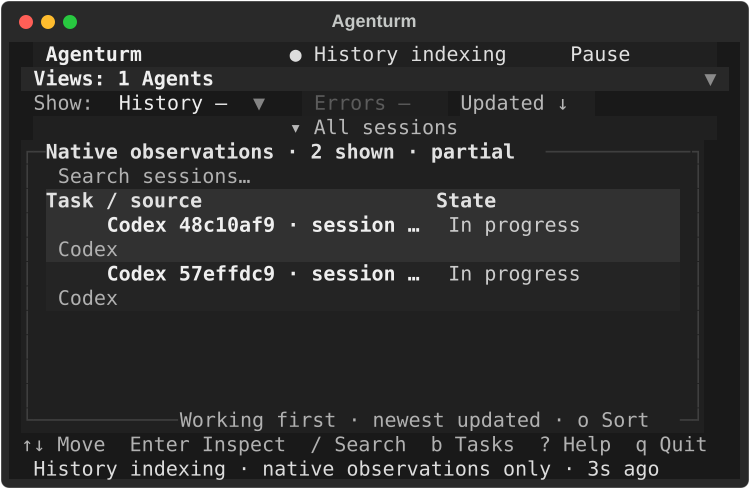
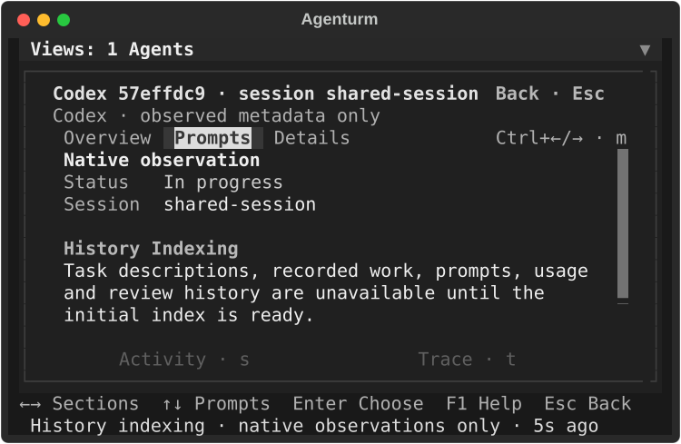
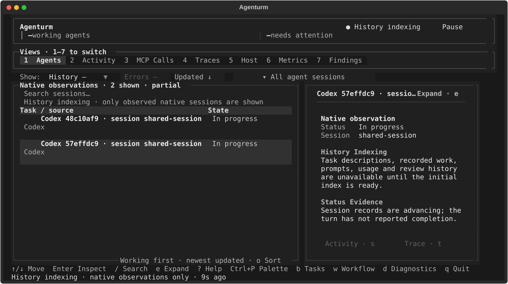

# Native observations before history is ready

The Agents view can now show a bounded native metadata frame while the initial retained-history index is still building. It remains explicitly partial: task text, recorded work, prompts, usage, historical counts, review and workflow actions stay unavailable.

This is a display improvement, not a claim that cold readiness, API availability or the writer deadline has been achieved. The complete snapshot clock remains zero until the ordinary coherent refresh succeeds. The unchanged full-history validation must still pass independently.

## Admission and publication

A cold Feed checks full authenticated health before starting historical API reads. Bootstrap requires an identified receiver, an explicit known indexing-in-progress state, enabled native monitoring, completed initial native polling, and a valid receiver clock. A second independent health read must identify the same receiver and still satisfy these conditions. Unknown readiness, migration failure, stopping and missing discovery proof do not become an apparently healthy native frame.

Publication rechecks scope, the capture safety epoch, stop state and initial-only admission under the existing Feed lock. Any coherent snapshot wins, even for another receiver when navigation and the old epoch are unchanged. A different partial receiver is not replaced by an older callback. Existing coherent snapshots retain their normal stale-data behavior; this path never downgrades them to metadata. New-namespace bootstrap requires an empty/reset Feed.

`Snapshot.native_bootstrap` and `bootstrap_updated` describe the partial frame. `Snapshot.updated` stays zero, `indexing_ready` stays false and native lifecycle history is empty. No cached session, Activity, trace, Findings, MCP, metric or usage page is borrowed. Cold/partial polling continues to check health without launching historical read batches prematurely.

Both observed health responses may revoke capture. Partial positive rows never restore existing global, actor or session denials. Policy overlays are followed by a second publication whitelist: private policy tombstones cannot reintroduce namespace paths or other old metadata. Only identities present in the final native observation remain display rows; missing rows may remain privately denied without masquerading as currently observed agents.

## What the partial view means

At most 500 rows are prepared. Source identifiers, shared canonical agent IDs and direct parent identifiers are validated. Duplicate source identities are omitted. Only bounded identity/status fields and current collector metadata are copied. Task, project, model, workspace/branch/path, last-event body, tool arguments, input reasons and stored parent context are excluded. Actual capture flags remain distinct from this temporary evidence-unavailable state.

A running or terminal label requires a recent successful collector read, explicit absence of backlog/pending storage, and consistent source/outcome clocks. Otherwise the row is unconfirmed. OpenCode rows that lack the required per-row freshness/backlog proof remain Unknown while history indexes; this slice deliberately adds no inference from global adapter diagnostics. Normal coherent OpenCode behavior is unchanged.

All aggregate cards remain `—`. A scoped “rows shown” caption describes only the available native list. An empty native response says that no matching native rows were observed; it does not establish zero agents or zero historical activity. If a later native refresh fails, authentication and stale-state messages remain visible, the last observation clock is retained, and rows do not continue claiming a confirmed live state.

The existing roster, tree, search, selection and inspector keys remain available. At 60×18, Enter opens the existing inspector and Ctrl+Left/Right switches its existing sections; each section explains why recorded content is unavailable. Activity, MCP, Traces, Host, Metrics and Findings remain keyboard reachable, but every render/search/selection entry point shows an unavailable state. Their paging controls say “History indexing,” not “Latest,” absence or a receiver-upgrade instruction. The ordinary views and paging return after coherent data arrives.

No partial native observation reaches lifecycle overlays, the workflow ledger, incident resolution, acknowledgements, delivery retries or error-seen receipts. Source capture, Review, summaries, usage, copying/exporting recorded evidence and trace navigation are gated. Independently authored saved-task data remains separate. Diagnostics names missing historical totals as unavailable instead of inventing zeros. `--once` never emits this frame as a complete snapshot; its existing incomplete exit contract remains in force.

## Narrow and wide frames

The minimum frame uses the existing single-pane fallback, without a new tab or panel. One existing status line communicates partial history; there is no repeated history banner on each agent row.

These are actual headless Textual frames from generated API data. Font fallback may differ from the user's terminal. No provider, native agent process or personal transcript was used for these images.

## The remaining startup dependency

The generated lock-contention preflight uses a real `LocalAgents` poll, one generated Codex-format source, a real Store and an authenticated HTTP health route. Personal source discovery, OpenCode database access, host process discovery and providers are disabled. A separate connection holds SQLite's writer for 150 ms.

While that writer is held, native ingestion has entered its real Store path, `initial_poll_complete` remains false, and the health request remains unfinished because health also persists hierarchy facts. After release, polling completes and Feed can publish metadata while the deliberately pending history state remains false. The raw preflight is retained in `native-bootstrap-lock-preflight.json`.

This proves a dependency, not a full retained-history speed result. Native ingestion and health-side hierarchy persistence can still wait on SQLite. Writer fairness and bounded derivation remain separate work. There is no demonstrated sub-30-second first-native frame on the full corpus, and the approximately six-minute prior coherent-cold problem is not relabelled as solved by this partial frame.

## Verification

The broader local Feed concurrency, source preparation, capture-revocation and Agents observation-deck run passed 99 tests in 217.666 seconds before the last narrow rendering refinements. The final native-bootstrap/once/workflow-controller gate passed 35 tests in 33.924 seconds with `ResourceWarning` treated as an error. It includes numeric 2–7 navigation, direct search/render callbacks, unknown paging, coherent restoration, Diagnostics, actual 60×18 keyboard use, late prompt/evidence buffers, same/different-receiver publication races, sticky denials, strict stage/clock rejection and the real writer-lock preflight. The overlapping run counts are not additive unique-test totals.

Independent reviewers reproduced and checked the canonical ID, policy-tombstone, different-receiver late-callback and missing-diagnostic-total boundaries. Final narrow source review found no remaining blocker; main integration and CI remain the release gates. No performance SLO or external adoption result is claimed here.
