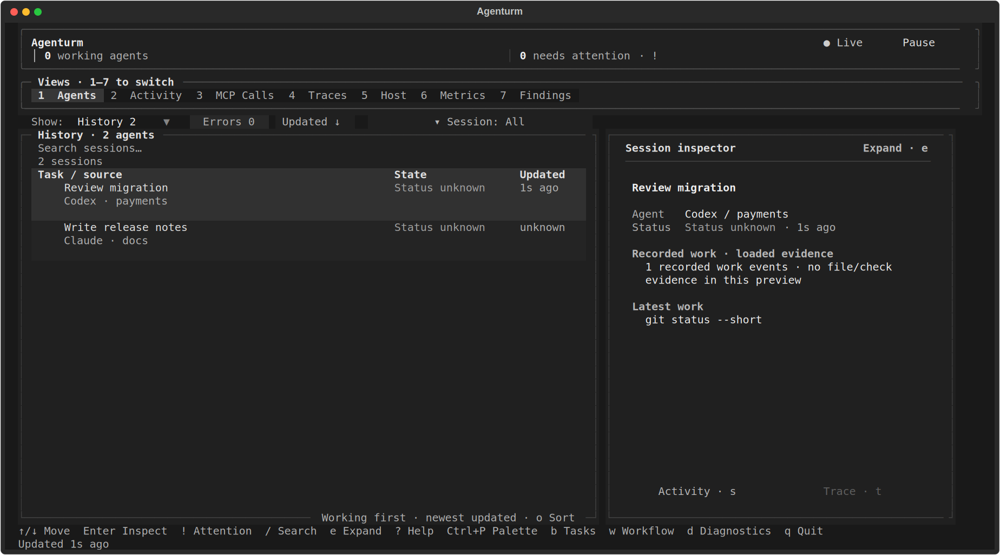
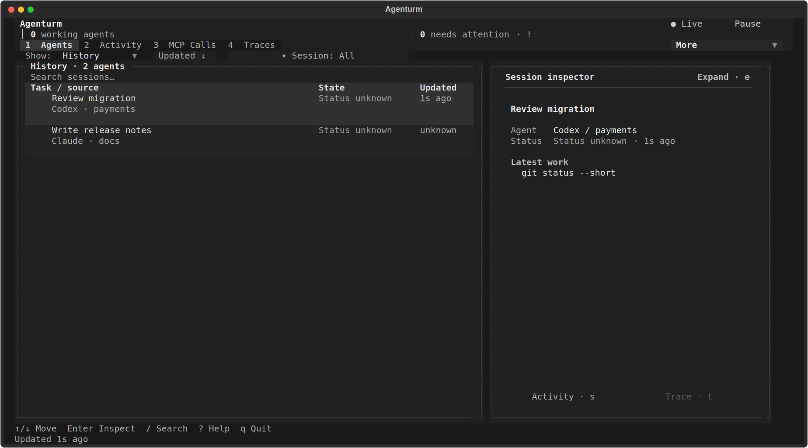

# A simpler Agenturm default view

The default workflow is to follow agents, select one, and inspect evidence when needed. Detailed capabilities remain available through the main tabs, More, inspector modes, Help and the command palette.

## Before and after

Synthetic data, same 150×40 terminal and session list. No personal transcripts are included.

### Before

### After

## What changed

- The header uses two rows on taller terminals and one on short terminals. Navigation uses one row. At 150×40 this removes four rows of header/navigation decoration. Header geometry remains independent of the selected view or expanded inspector.
- Agents, Activity, MCP Calls and Traces remain directly visible. Host, Metrics and Findings move to More at every width; keys 1–7 still work. Below 76 columns a single labelled menu contains all seven destinations.
- The footer shows five everyday actions: Move, Inspect, Search, Help and Quit, down from twelve at wide sizes. Other commands retain their bindings and Help/palette entries.
- The list keeps its matching count once. Repeated Show-option counts, equal agent/row counts, the sort subtitle and the healthy populated-list summary are removed. Search feedback, empty states, history failures and indexing warnings remain visible.
- Errors 0 is hidden unless that filter is selected. Nonzero unseen errors retain their control and existing acknowledgement behavior. During startup indexing, the disabled Errors — control remains visible because the count is still unknown.
- Overview shows progress and useful recorded edits/checks/issues. It no longer repeats the latest command in a Recent work trail, generic record counts in multiple sections, or normal-state provenance boilerplate. Activity retains the full history; Details retains status provenance, evidence coverage, hierarchy and usage. Explicit interruption and reply/approval explanations stay visible.
- A validation event already shown in Recent validation is not repeated as the latest event. This uses its exact source reference; separate runs of the same command remain distinct.

## Layout and clutter audit

Two decorative frames are removed: the global masthead border and the view-navigation border. Data panes retain one border; there are no nested borders around them. No new per-row markers or status signals are added. At 150×40, the header/navigation/toolbar occupy four rows instead of eight, leaving more room for evidence. This measures rows reserved above the workspace, not a claim about every nonblank cell.

At 80×24 the list is the default pane and Enter opens the inspector. At 60×18, one view menu and the existing two-row session toolbar remain stable; the reader preserves scrolling and its controls. Below 60×18 the existing too-small message remains authoritative. Empty, loading and unavailable-evidence text is retained rather than hidden as decoration.

## Validation

The focused simplification journey verifies that a normal command appears once, Details retains provenance/coverage, Activity opens the selected session, and active empty filters/searches remain visible. Source-reference checks ensure repeated commands from different sessions, agents, receivers or turns are never collapsed together.

The targeted regression run exercised 93 tests covering branding, navigation, list/inspector layouts, stable view geometry, interruption evidence and session evidence. One assertion still expected the removed masthead border's exact offset; it was changed to verify containment within the header content region and passed on rerun. The other 92 tests passed. A separate 14-test run for error acknowledgement, compact controls and native-history startup passed. A final run of all ten branding tests plus both new simplification/source-identity tests passed (12 tests). Across these runs, 109 distinct targeted tests passed after the border assertion update. Visual checks used 150×40, 80×24 and 60×18 renders, including an expanded reader at the minimum supported size.

This is targeted local validation, not a claim that the entire repository test suite has completed. The full Python-version matrix and integration checks run in GitHub Actions.

This change does not implement the proposed harness-adapter architecture or publish a new package release. Restart the TUI after updating a local checkout.
